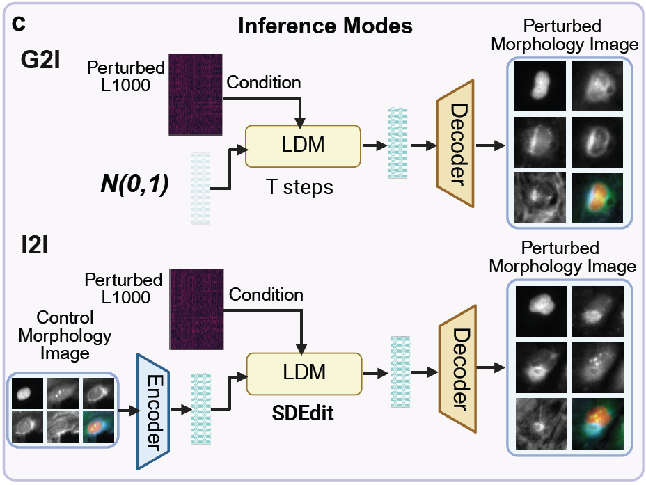
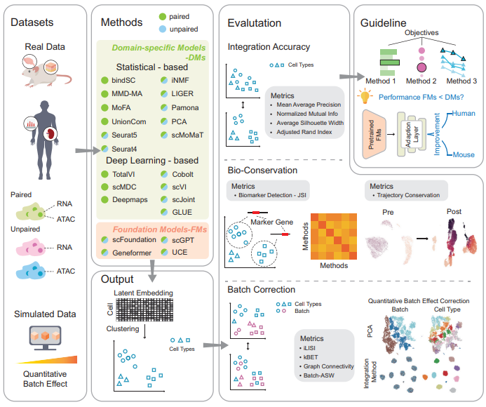
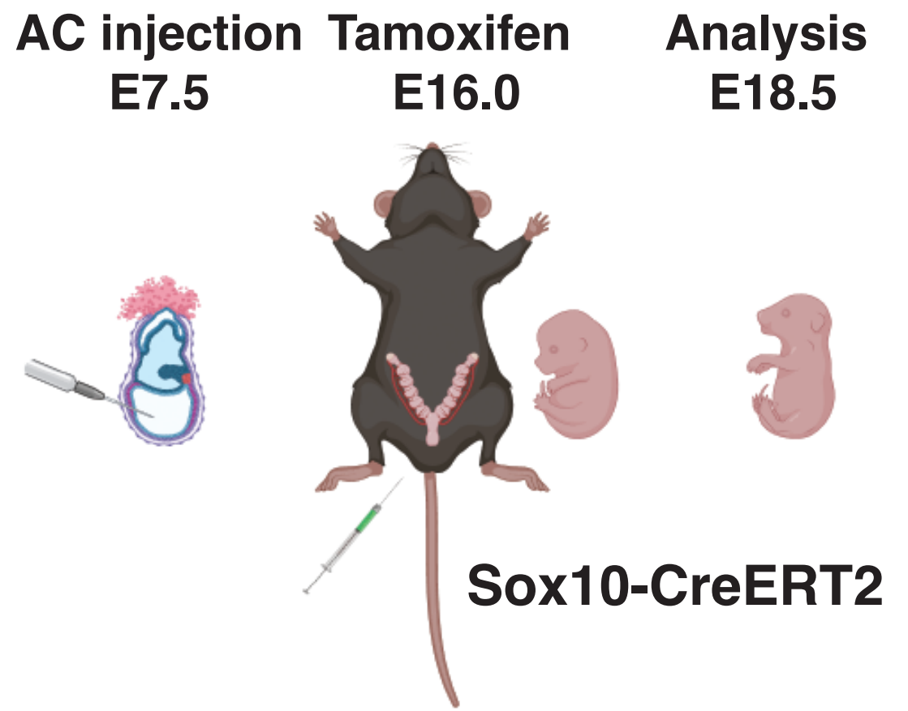
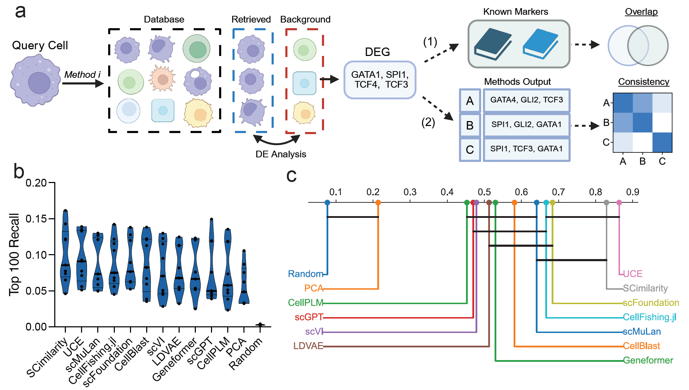
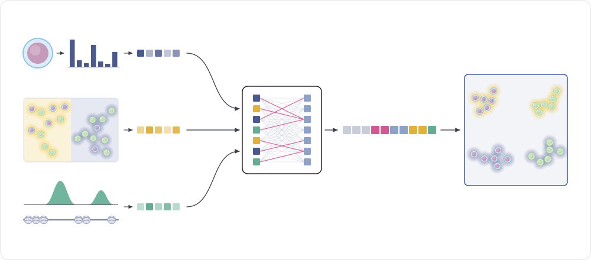

## Journal Publications

† denotes equal contribution  

  

    <h3><a href="https://www.nature.com/articles/s41467-025-63478-z" target="_blank">Prediction of Cellular Morphology Change Under Perturbations with Transcriptome-Guided Diffusion Model</a></h3>
    
    
<strong>Authors:</strong> Xuesong Wang†, Yimin Fan†, Yucheng Guo, Chenghao Fu, Kinhei Lee, Khachatur Dallakyan, Yaxuan Li, Qijin Yin, Yu Li, and Le Song

    
    
<strong>Journal:</strong> Nature Communications

  

  
  

    
  

  

    <h3><a href="https://www.nature.com/articles/s41467-026-72570-x" target="_blank">SCMBench: Benchmarking Domain-specific and Foundation Models for Single-cell Multi-omics Data Integration</a></h3>
    
    
<strong>Authors:</strong> Yixuan Wang†, Yimin Fan†, Xuesong Wang†, Tingyang Yu†, Yongshuo Zong†, Xinyuan Liu, Gaoyang Zhong, Meitong Liu, Qing Li, Kin Hei Lee, Khachatur Dallakyan, Zhichao Hu, Yaqian Qi, Junjie Huang, Gengjie Jia, Jiao Yuan, Ting-Fung Chan, Xin Gao, Irwin King, Yu Li

    
    
<strong>Journal:</strong> Nature Communications

  

  
  

    
  

  

    <h3><a href="https://www.pnas.org/doi/10.1073/pnas.2614077123" target="_blank">Resolving cell lineages and gene functions in the developing mouse gastrointestinal tract using in utero transduction</a></h3>
    
    
<strong>Authors:</strong> Ziwei Liu†, Krishnanand Padmanabhan†, Jingyan He, Katrin Hector, Bettina Semsch, Jia Sun, Viktoria Knoflach, Sarantis Giatrellis, Johan Lorentz, Khachatur Dallakyan, Christian Göritz, Emma Rachel Andersson, Ulrika Marklund

    
    
<strong>Journal:</strong> Proceedings of the National Academy of Sciences (PNAS)

  

  
  

    
  

## Preprints

† denotes equal contribution  

  

    <h3>Systematic Benchmarking of Single-cell Transcriptomics Search Engines</h3>
    
    
<strong>Authors:</strong> Yimin Fan†, Kin Hei Lee†, Xinyuan Liu†, Khachatur Dallakyan†, Seyoung Jin†, Baekgyu Choi, Xuesong Wang, Yixuan Wang, Licheng Zong, Yue Li, Inkyung Jung, Yu Li

    
    
<strong>Journal:</strong> Nature Methods

  

  
  

    
  

## Current Major Projects

  <h3>Bringing New Modalities into Single-Cell Foundation Models</h3>

  
My main project is bringing new modalities into single-cell foundation models. Today's models learn from the gene expression of dissociated cells, so they know what a cell expresses but not where it sits in the tissue or which parts of its genome are open. I am extending them, starting from the lab's scPRINT models, to read spatial transcriptomics and then chromatin accessibility, so that one model gives one embedding that keeps cell identity and adds tissue context: a step towards a multimodal virtual cell.

  <figure class="project-figure">
    
  </figure>

